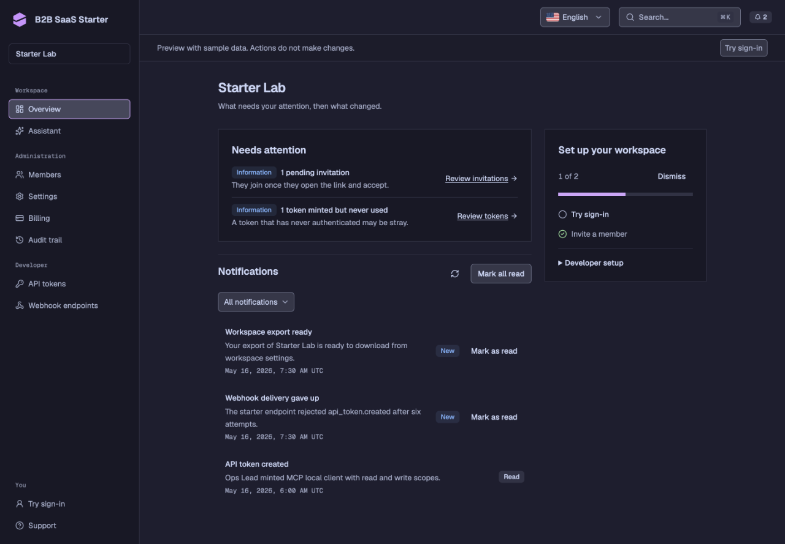
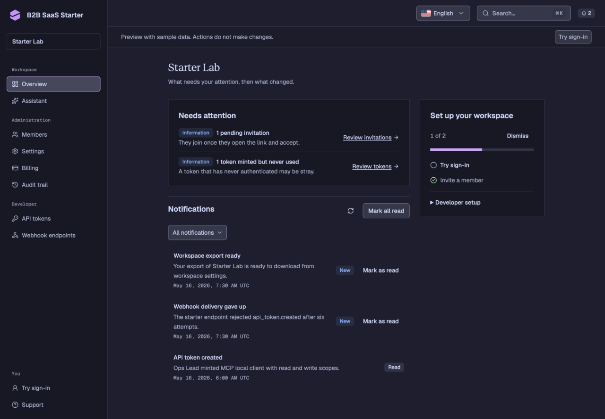
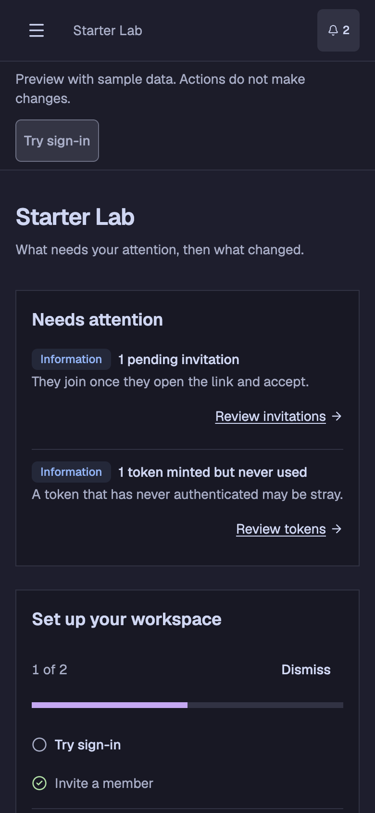
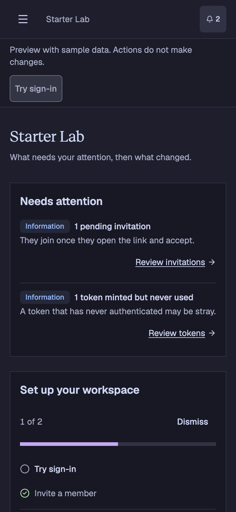

# App page title verification

The shared `PageHeader` supplies workspace, account, and admin page titles.
It now uses Geist Serif Regular at the existing 24px size, with the font
preload colocated in the header. Panels, data, controls, and navigation retain
Geist Sans or Mono.

## Reproduce

```sh
pnpm -C packages/i18n generate
pnpm run db:migrate:local
pnpm run db:seed
pnpm -C apps/web run build:e2e
pnpm -C apps/web run serve:e2e --port 3181 --strictPort
```

Visit `/` to select English, then `/demo`, which renders the real workspace
overview component with sample data. Capture at 1440 × 1000 and 390 × 844 CSS
pixels after `document.fonts.ready`. Before images were captured on `1dcbae7b`;
the intervening public/auth title change leaves this app header unchanged.

## Observed results

- The page title loads Geist Serif at weight 400. Panel headings stay in Geist Sans.
- English and Norwegian overview pages fit at desktop and mobile widths without
  horizontal overflow.
- The page requests one serif WOFF2. The preload matches the CSS asset.
- The landing-page workspace preview images were refreshed from `/demo` at
  1440 × 1000 and 390 × 720, encoded as lossless WebP.

| Viewport | Before                                | After                               |
| -------- | ------------------------------------- | ----------------------------------- |
| Desktop  |  |  |
| Mobile   |    |    |
