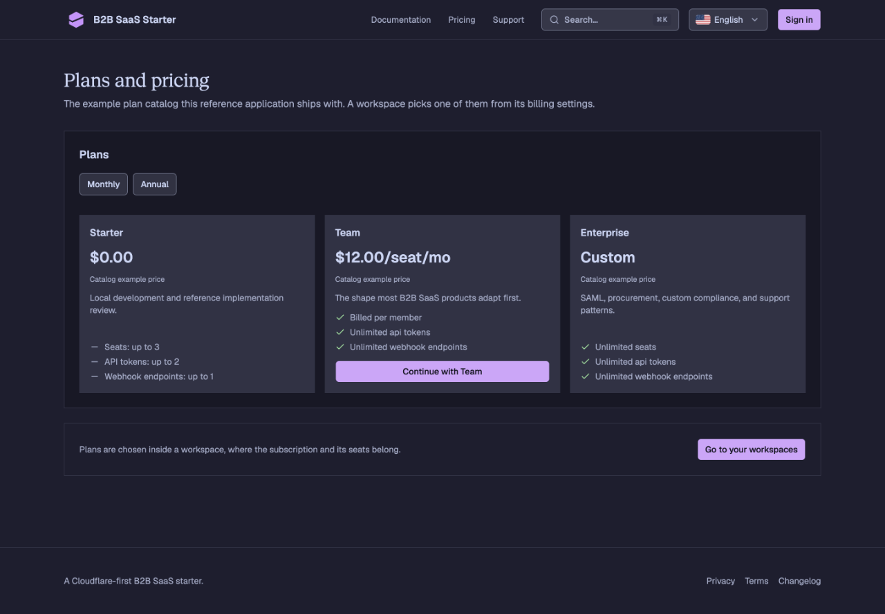
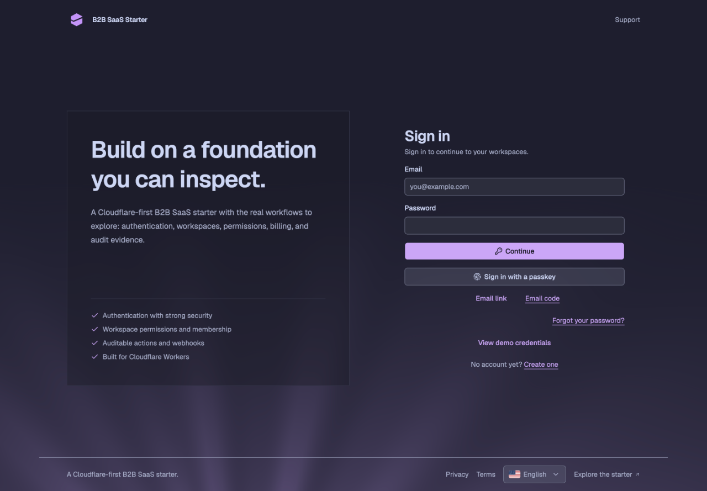
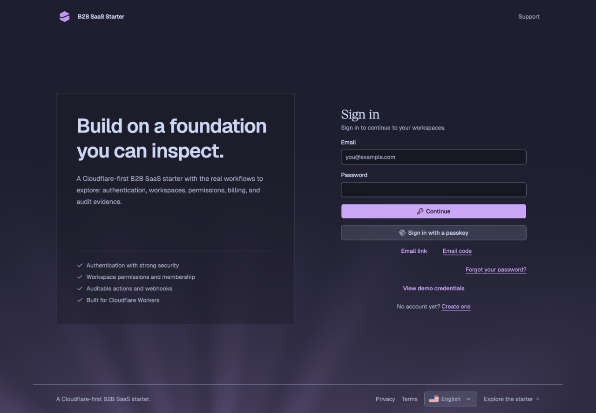
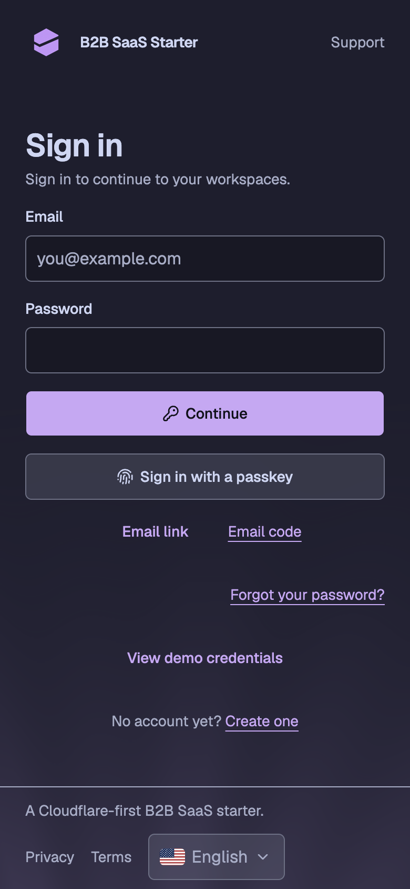
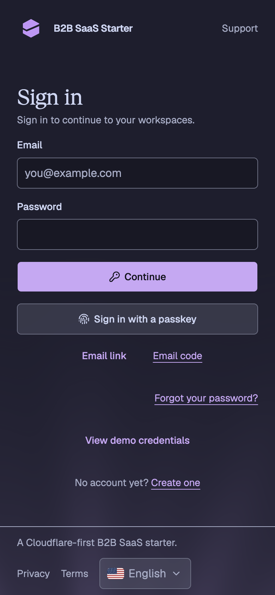

# Public and auth page titles

The comparison starts at `1dcbae7b`, the landing-only Geist Serif implementation.
The after images use this directory's accompanying changes.

## Reproduce

```sh
pnpm -C packages/i18n generate
pnpm run db:migrate:local
pnpm run db:seed
pnpm -C apps/web run build:e2e
pnpm -C apps/web run serve:e2e --port 3181 --strictPort
```

Visit `/pricing` and `/sign-in` at 1440 × 1000 CSS pixels, then `/sign-in`
at 390 × 844. Wait for `document.fonts.ready` before each screenshot.

## Results

Pricing and sign-in page titles resolve to Geist Serif, weight 400.
Body copy and form fields resolve to Geist Sans. Both desktop pages and the
mobile sign-in form fit without horizontal overflow. Norwegian docs at
`/no/docs/getting-started/quickstart` also load the serif title without overflow
at 390px. Compact auth-card headings retain their existing sans treatment.

| Page            | Before                                      | After                                     |
| --------------- | ------------------------------------------- | ----------------------------------------- |
| Pricing         |        |        |
| Sign-in desktop |        |        |
| Sign-in mobile  |  |  |
